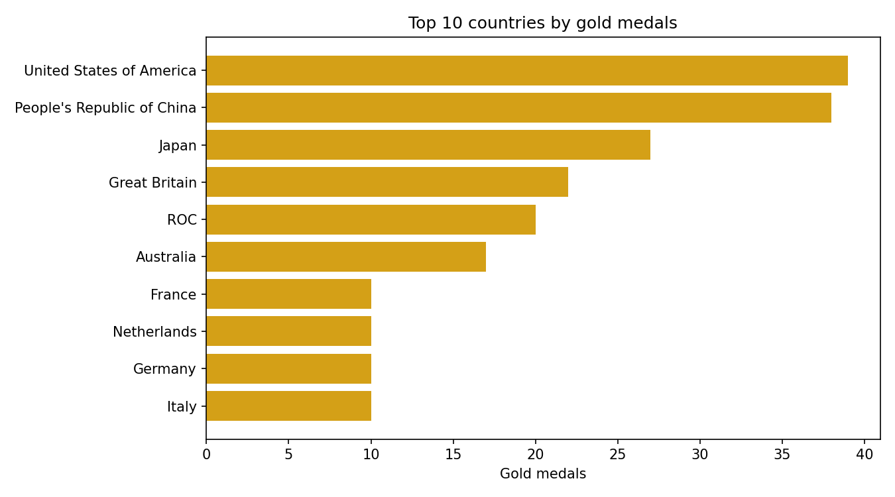
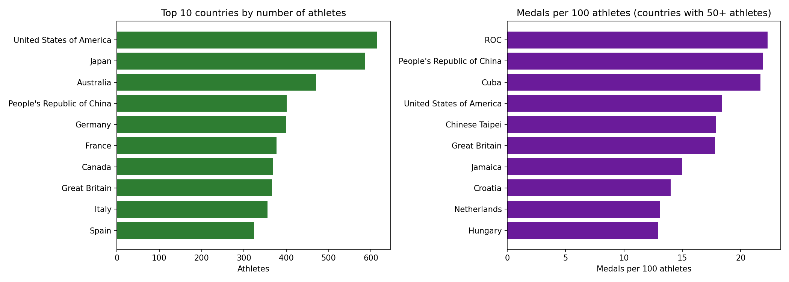

# Tokyo 2020 Olympics: PySpark ETL and Analysis

[](https://colab.research.google.com/github/SaeeR18/Olympic-Data-Analysis-Project/blob/main/notebooks/olympic_etl_analysis.ipynb)

An end-to-end data engineering project on the Tokyo 2020 Olympics data. A PySpark notebook reads five raw CSV files, checks and cleans them, saves them as Parquet in two layers (cleansed and curated), and answers questions about medals, athletes and gender participation with Spark SQL and charts.

## About this project

This project was first built on Azure (Azure Data Factory, Azure Databricks, Azure Synapse) by following this tutorial: https://youtu.be/IaA9YNlg5hM

The Azure resources are no longer available, so this repository contains a **local PySpark rebuild of the same ETL and analysis** that runs for free in Google Colab. The Azure pipeline itself is not included here.

## Pipeline

```
data/raw (5 CSV files)
      |
      |  Extract: read with PySpark (correct encoding per file)
      v
Data quality checks: nulls, duplicates, totals, join keys
      |
      |  Transform: trim text, rename columns, fix broken characters,
      |             fill empty values, remove duplicates
      v
data/cleansed (5 Parquet tables)
      |
      |  Build analysis tables: country summary, gender by discipline,
      |                         athletes by discipline
      v
data/curated (3 Parquet tables)
      |
      |  Spark SQL queries + matplotlib charts
      v
images/ (5 charts)
```

## Dataset

| File | Rows | Columns |
|---|---|---|
| Athletes.csv | 11,085 | PersonName, Country, Discipline |
| Coaches.csv | 394 | Name, Country, Discipline, Event |
| EntriesGender.csv | 46 | Discipline, Female, Male, Total |
| Medals.csv | 93 | Rank, TeamCountry, Gold, Silver, Bronze, Total, Rank by Total |
| Teams.csv | 743 | TeamName, Discipline, Country, Event |

Row counts are without the header row.

## Data issues found and fixed

- **Mixed encodings.** Athletes, Coaches and Teams are saved in ISO-8859-1, so reading them as UTF-8 breaks names like Côte d'Ivoire. Each file is read with the right encoding.
- **Damaged characters in Medals.csv.** The country name Côte d'Ivoire is already damaged in the file, so it did not match the Athletes table. It is fixed before joining.
- **Empty values.** 145 of the 394 coach rows have an empty `event`. They are filled with "Not specified".
- **Duplicates.** One exact duplicate row each in Athletes and Coaches is removed.
- **Consistency checks.** Gold + silver + bronze equals total in Medals, and female + male equals total in EntriesGender, for every row.

## Questions answered with Spark SQL

1. Which 10 countries won the most gold medals?
2. How are gold, silver and bronze split for the top 10 countries by total medals?
3. How do female and male entries compare across the biggest disciplines?
4. Which disciplines are the most female-dominated and the most male-dominated?
5. Which countries sent the most athletes, and which won the most medals per 100 athletes?
6. Does sending more athletes mean winning more medals?

## Results

| Question | Result |
|---|---|
| Most gold medals | United States of America (39), People's Republic of China (38), Japan (27) |
| Overall entries | 11,316, of which 5,432 female and 5,884 male |
| Female-only disciplines | Artistic Swimming and Rhythmic Gymnastics (100% female entries) |
| Lowest female share (disciplines with 50+ entries) | Wrestling (33.2%), Cycling Road (34.8%), Boxing (35.3%) |
| Medals per 100 athletes (countries with 50+ athletes) | ROC (22.3), People's Republic of China (21.9), Cuba (21.7) |
| Athletes vs medals | Correlation of 0.88 across countries |

Charts are in the `images/` folder.




## Tech stack

Python, PySpark, Spark SQL, Parquet, pandas, matplotlib, Google Colab, Git

## How to run

1. Click the **Open in Colab** badge above.
2. Choose **Runtime, then Run all**. It takes about 2 to 3 minutes.
3. The notebook downloads this repository, reads the CSV files, and writes the `data/cleansed`, `data/curated` and `images` folders inside the Colab session.

To run on your own computer, install Java and `pip install pyspark pandas matplotlib`, then open the notebook in Jupyter inside the project folder.

## Folder structure

```
Olympic-Data-Analysis-Project/
├── data/
│   ├── raw/          <- the 5 original CSV files
│   ├── cleansed/     <- cleaned tables (Parquet)
│   └── curated/      <- tables built for analysis (Parquet)
├── notebooks/
│   └── olympic_etl_analysis.ipynb
├── images/           <- charts made by the notebook
├── .gitignore
└── README.md
```

## What I would improve next

- Add automated data tests (for example with Great Expectations).
- Schedule the pipeline with Apache Airflow.
- Rebuild the cloud version on a free tier and compare cost and speed.
